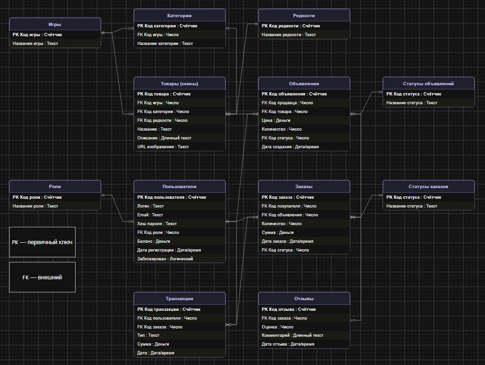

# SKINMARKET

**SKINMARKET** — учебный веб-маркетплейс игровых предметов (скинов), в котором пользователи могут размещать объявления, просматривать предложения других продавцов и оформлять покупки.

Проект разработан на Python с использованием Flask и базы данных Microsoft Access.

## Возможности проекта

### Пользователи
- Регистрация и вход в аккаунт.
- Авторизация через Steam.
- Просмотр и редактирование профиля.
- Просмотр баланса и истории операций.
- Разграничение прав доступа по ролям.

### Каталог
- Просмотр игровых предметов.
- Поиск по названию.
- Фильтрация по игре, категории, редкости и цене.
- Сортировка предложений.
- Просмотр подробной информации о товаре.
- Просмотр профиля продавца и его объявлений.

### Инвентарь Steam
- Получение предметов из Steam-инвентаря пользователя.
- Просмотр предметов с изображениями и названиями.
- Переключение между доступными играми.
- Поиск и фильтрация предметов.
- Выбор предмета для создания объявления.

### Продажа предметов
- Создание объявления на основе предмета из Steam-инвентаря.
- Указание категории, редкости и цены.
- Размещение объявления в каталоге.
- Управление собственными объявлениями.
- Просмотр заказов покупателей.

### Покупки и заказы
- Добавление товаров в корзину.
- Оформление заказа с внутреннего демо-баланса.
- Просмотр списка заказов.
- Отслеживание статуса сделки.
- Возврат средств при отмене заказа.

### Сообщения
- Чат между покупателем и продавцом.
- Обмен сообщениями на странице заказа.
- Согласование передачи игрового предмета.

### Административная панель
- Просмотр статистики сайта.
- Управление пользователями.
- Изменение ролей и блокировка аккаунтов.
- Управление объявлениями и товарами.
- Добавление и редактирование игр.
- Управление категориями и редкостями.
- Замена изображений предметов.
- Просмотр заказов и информации о сделках.

## Используемые технологии

| Область | Технологии |
|---|---|
| Язык программирования | Python 3 |
| Серверная часть | Flask, Jinja2 |
| База данных | Microsoft Access (.accdb) |
| Подключение к БД | pyodbc, ODBC |
| Клиентская часть | HTML5, CSS3, JavaScript |
| Авторизация Steam | Steam OpenID |
| Данные Steam | Steam Web API |
| Настройки | python-dotenv |

## База данных

Для хранения информации используется Microsoft Access.

База данных содержит 12 таблиц с русскими названиями. В ней хранятся данные пользователей, роли, игры, категории, редкости, товары, объявления, заказы, транзакции и отзывы.

Связи между таблицами обеспечивают целостность данных.

### ER-диаграмма

ER-диаграмма отображает структуру базы данных и связи между основными таблицами.




erDiagram
    ИГРЫ ||--o{ КАТЕГОРИИ : содержит
    ИГРЫ ||--o{ ТОВАРЫ : включает
    КАТЕГОРИИ ||--o{ ТОВАРЫ : относится
    РЕДКОСТИ ||--o{ ТОВАРЫ : определяет
    ТОВАРЫ ||--o{ ОБЪЯВЛЕНИЯ : используется
    СТАТУСЫ_ОБЪЯВЛЕНИЙ ||--o{ ОБЪЯВЛЕНИЯ : определяет
    ПОЛЬЗОВАТЕЛИ ||--o{ ОБЪЯВЛЕНИЯ : размещает
    РОЛИ ||--o{ ПОЛЬЗОВАТЕЛИ : назначается
    ПОЛЬЗОВАТЕЛИ ||--o{ ЗАКАЗЫ : оформляет
    ОБЪЯВЛЕНИЯ ||--o{ ЗАКАЗЫ : покупается
    СТАТУСЫ_ЗАКАЗОВ ||--o{ ЗАКАЗЫ : определяет
    ПОЛЬЗОВАТЕЛИ ||--o{ ТРАНЗАКЦИИ : совершает
    ЗАКАЗЫ ||--o{ ТРАНЗАКЦИИ : связаны
    ЗАКАЗЫ ||--o{ ОТЗЫВЫ : получает

    ИГРЫ {
        int Код_игры PK
        string Название_игры
    }

    КАТЕГОРИИ {
        int Код_категории PK
        int Код_игры FK
        string Название_категории
    }

    РЕДКОСТИ {
        int Код_редкости PK
        string Название_редкости
    }

    ТОВАРЫ {
        int Код_товара PK
        int Код_игры FK
        int Код_категории FK
        int Код_редкости FK
        string Название
        string Описание
        string URL_изображения
    }

    ОБЪЯВЛЕНИЯ {
        int Код_объявления PK
        int Код_пользователя FK
        int Код_товара FK
        float Цена
        int Количество
        int Код_статуса FK
        datetime Дата_создания
    }

    СТАТУСЫ_ОБЪЯВЛЕНИЙ {
        int Код_статуса PK
        string Название_статуса
    }

    РОЛИ {
        int Код_роли PK
        string Название_роли
    }

    ПОЛЬЗОВАТЕЛИ {
        int Код_пользователя PK
        string Логин
        string Email
        string Хеш_пароля
        int Код_роли FK
        float Баланс
        datetime Дата_регистрации
        boolean Заблокирован
    }

    ЗАКАЗЫ {
        int Код_заказа PK
        int Код_пользователя FK
        int Код_объявления FK
        int Количество
        float Сумма
        datetime Дата_заказа
        int Код_статуса FK
    }

    СТАТУСЫ_ЗАКАЗОВ {
        int Код_статуса PK
        string Название_статуса
    }

    ТРАНЗАКЦИИ {
        int Код_транзакции PK
        int Код_пользователя FK
        int Код_заказа FK
        string Тип
        float Сумма
        datetime Дата
    }

    ОТЗЫВЫ {
        int Код_отзыва PK
        int Код_заказа FK
        int Оценка
        string Комментарий
        datetime Дата_отзыва
    }


## Структура проекта

```text
skinmarket/
│
├── server.py                 # Основное Flask-приложение
├── db.py                     # Работа с базой данных
├── database.accdb            # База данных Microsoft Access
├── steam_inventory.py        # Работа с инвентарём Steam
├── make_admin.py             # Управление администратором
├── seed_demo.py              # Демонстрационные данные
├── fetch_game_images.py      # Загрузка изображений игр
├── requirements.txt          # Зависимости Python
├── README.md                 # Описание проекта
├── er.jpg                    # ER-диаграмма
├── er.drawio                 # Исходник ER-диаграммы
├── .env                      # Локальные настройки
├── secret.key                # Ключ сессий
├── carts.json                # Данные корзин
│
├── templates/                # HTML-шаблоны
│
├── static/
│   ├── css/                  # Стили сайта
│   ├── js/                   # JavaScript
│   ├── game_images/          # Изображения игр
│   └── skin_images/          # Изображения предметов
│
└── tests/                    # Автоматические тесты
```

## Установка и запуск

### 1. Требования

Для запуска проекта необходимы:

- Windows.
- Python 3.
- Microsoft Access Database Engine с ODBC-драйвером.
- Steam API Key для функций, использующих Steam Web API.

Разрядность Python и установленного ODBC-драйвера Access должна совпадать.

### 2. Установка зависимостей

Откройте терминал в папке проекта и выполните:

```bash
pip install -r requirements.txt
```

### 3. Настройка проекта

Создайте или проверьте файл `.env` в корневой папке проекта.

В нём указываются необходимые настройки приложения, включая параметры подключения к базе данных и Steam API Key.

Также должен присутствовать файл `secret.key`, используемый для работы с сессиями.

### 4. Запуск приложения

Перед запуском убедитесь, что файл `database.accdb` закрыт в Microsoft Access.

Запустите приложение командой:

```bash
python server.py
```

### 5. Открытие сайта

После запуска откройте браузер и перейдите по адресу:

```text
http://127.0.0.1:3000
```
