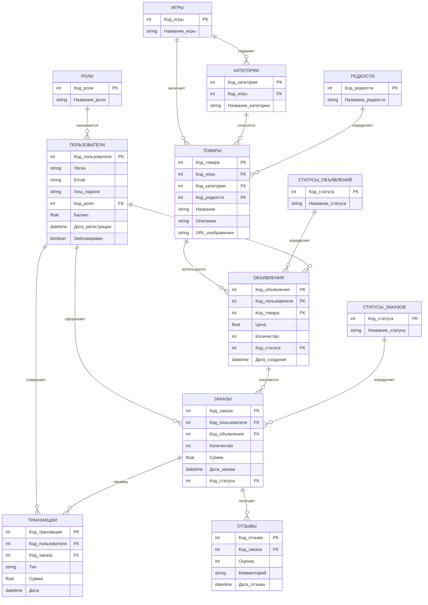

# SKINMARKET

**SKINMARKET** — учебный веб-маркетплейс игровых предметов (скинов). Сайт позволяет пользователям просматривать предложения, покупать игровые предметы и размещать собственные объявления.

Проект разработан на Python с использованием Flask и базы данных Microsoft Access.

## Возможности проекта

### Регистрация и авторизация
- Регистрация и вход в аккаунт.
- Авторизация через Steam.
- Просмотр профиля пользователя.
- Разграничение прав доступа по ролям.

### Каталог игровых предметов
- Просмотр доступных игровых предметов.
- Поиск по названию.
- Фильтрация по игре, категории и редкости.
- Фильтрация по диапазону цен.
- Сортировка предложений.
- Просмотр подробной информации о товаре.
- Просмотр профиля продавца и его объявлений.

### Инвентарь Steam
- Получение предметов из инвентаря Steam.
- Просмотр предметов с изображениями и названиями.
- Переключение между доступными играми.
- Поиск и фильтрация предметов.
- Выбор предмета для создания объявления.

### Продажа предметов
- Создание объявления непосредственно из инвентаря Steam.
- Выбор категории и редкости предмета.
- Указание стоимости.
- Добавление объявления в каталог.
- Просмотр собственных объявлений.
- Управление размещёнными предложениями.

### Корзина и заказы
- Добавление товаров в корзину.
- Оформление заказа.
- Оплата с использованием внутреннего баланса.
- Просмотр своих заказов.
- Просмотр информации о сделке.
- Отслеживание статуса заказа.

### Сообщения
- Чат между покупателем и продавцом.
- Обмен сообщениями на странице заказа.
- Согласование передачи игрового предмета.

### Административная панель
- Просмотр статистики сайта.
- Управление пользователями.
- Изменение ролей пользователей.
- Блокировка и разблокировка аккаунтов.
- Управление играми и категориями.
- Управление редкостями.
- Просмотр товаров и объявлений.
- Управление изображениями предметов.
- Просмотр заказов и информации о сделках.
- Экспорт данных.

## Используемые технологии

| Область | Технологии |
|---|---|
| Язык программирования | Python 3 |
| Серверная часть | Flask |
| Шаблоны страниц | Jinja2 |
| База данных | Microsoft Access |
| Подключение к базе данных | pyodbc, ODBC |
| Клиентская часть | HTML5, CSS3, JavaScript |
| Авторизация Steam | Steam OpenID |
| Работа с данными Steam | Steam Web API |
| Настройки приложения | python-dotenv |

## База данных

Для хранения информации используется Microsoft Access (`.accdb`).

База данных содержит таблицы для хранения информации об играх, категориях, редкостях, товарах, объявлениях, пользователях, ролях, заказах, транзакциях и отзывах.

Для организации данных используются первичные и внешние ключи, которые связывают таблицы между собой.

### ER-диаграмма

ER-диаграмма показывает структуру базы данных SKINMARKET, основные таблицы, их поля и связи между ними.




## Установка и запуск

### Требования

Для запуска проекта необходимы:

- Windows.
- Python 3.
- Microsoft Access Database Engine с установленным ODBC-драйвером.
- Steam API Key для работы функций Steam Web API.

Важно, чтобы разрядность Python и ODBC-драйвера Microsoft Access совпадала.

### 1. Установка зависимостей

Откройте терминал в папке проекта и выполните команду:

```bash
pip install -r requirements.txt
```

### 2. Настройка проекта

В корневой папке проекта должен находиться файл `.env` с необходимыми настройками приложения.

В нём указываются параметры, необходимые для работы проекта, включая настройки Steam API и подключения к базе данных.

Также проверьте наличие файла `secret.key`, если он используется текущей конфигурацией приложения.

### 3. Запуск приложения

Перед запуском убедитесь, что база данных не открыта в Microsoft Access.

В терминале выполните:

```bash
python server.py
```

### 4. Открытие сайта

После запуска приложения откройте браузер и перейдите по адресу:

```text
http://127.0.0.1:3000
```
