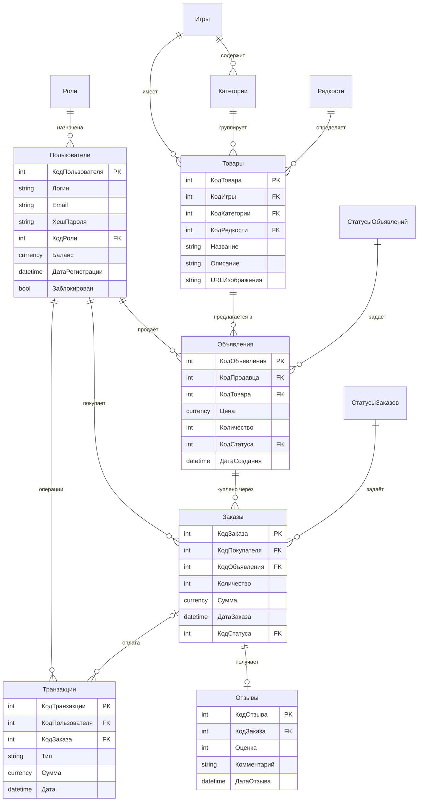

# SKINMARKET

Онлайн-маркетплейс игровых скинов. Пользователи покупают и продают предметы друг у друга. Площадка принимает оплату, удерживает деньги до выполнения заказа и возвращает их при отмене. По идее проект похож на FunPay и GGSEL.

> Учебный проект. Оплата работает на внутреннем демо-балансе. Реальные платежи не используются.

Полное словесное описание проекта: [`Описание_проекта_SKINMARKET.docx`](Описание_проекта_SKINMARKET.docx).

## Возможности

**Каталог**
- Карточки скинов с картинкой, игрой, категорией, редкостью, ценой и продавцом.
- Поиск по названию и игре.
- Фильтры: игра, категория (зависит от игры), редкость, цена.
- Сортировка: новые, дешевле, дороже, по названию.
- Плитки игр с логотипами, постраничный вывод.

**Покупатель**
- Регистрация, вход, профиль.
- Корзина и покупка с баланса.
- Отмена оплаченного заказа, возврат денег.
- Отзывы о продавцах (оценка 1–5).
- Пополнение и вывод баланса (демо), история операций.

**Продавец**
- Объявления с картинкой (файл или ссылка), ценой и количеством.
- Изменение цены и количества, снятие с продажи.
- Заказы покупателей, кнопка «Товар передан».

**Администратор**
- Блокировка пользователей, смена ролей.
- Снятие объявлений, просмотр заказов, статистика.
- Каталог: игры с логотипами, категории, редкости, скины с картинкой и ценой.

## Технологии

| Область | Что используется |
|---|---|
| Сервер | Python 3, Flask, Jinja2 |
| База данных | Microsoft Access (`.accdb`), `pyodbc` |
| Клиент | HTML, CSS, JavaScript |
| Настройки | `python-dotenv` |
| Тесты | `pytest` |

## Структура репозитория

```text
SKINMARKET/
├── skinmarket/              # сайт
│   ├── server.py            # маршруты и логика
│   ├── db.py                # доступ к базе
│   ├── database.accdb       # база данных сайта
│   ├── make_admin.py        # создать администратора
│   ├── seed_demo.py         # демо-данные
│   ├── fetch_game_images.py # картинки игр из Steam
│   ├── templates/           # HTML-шаблоны
│   ├── static/              # css, js, картинки
│   └── tests/               # автотесты
├── requirements.txt         # зависимости
├── skinmarket.accdb         # база данных
├── Описание_проекта_SKINMARKET.docx
└── README.md
```

## Быстрый старт

Нужно:
- Windows;
- Python 3.10 или новее;
- драйвер Access ([Microsoft Access Database Engine](https://www.microsoft.com/en-us/download/details.aspx?id=54920)). **Разрядность Python и драйвера должна совпадать** (64-бит и 64-бит).

```powershell
git clone https://github.com/X1nQ2/SKINMARKET.git
cd SKINMARKET\skinmarket
pip install -r requirements.txt
python server.py
```

Перед запуском закройте файл `database.accdb` в Access.

Сайт откроется на http://127.0.0.1:3000. Из локальной сети: `http://IP-компьютера:3000` (IP показывает команда `ipconfig`). При первом запуске разрешите Python доступ в брандмауэре Windows.

При старте сайт сам:
- создаёт администратора с логином `rrrr` (пароль задан в `server.py`, константа `DEFAULT_ADMIN`);
- добавляет в каталог игры CS2, Dota 2, Rust, Team Fortress 2, PUBG: Battlegrounds и Apex Legends с категориями.

### Дополнительные команды

```powershell
python make_admin.py логин      # сделать пользователя администратором
python seed_demo.py             # демо-скины и пользователи seller_demo / buyer_demo
python fetch_game_images.py     # скачать картинки игр из Steam (нужен интернет)
pytest                          # автотесты
```

## Настройки

Создайте файл `.env` рядом с `server.py`:

```ini
DB_PATH=database.accdb
MAX_TOPUP=100000
PLAIN_PASSWORDS=1
```

| Параметр | Значение |
|---|---|
| `DB_PATH` | Путь к файлу базы |
| `MAX_TOPUP` | Максимальное пополнение баланса за раз |
| `PLAIN_PASSWORDS` | `1` — пароли в базе видны открытым текстом (для показа проекта). `0` — хранится хеш |

## Как проходит сделка

1. Продавец размещает объявление.
2. Покупатель оплачивает: деньги списываются с его баланса и удерживаются. Заказ — «Оплачен».
3. Продавец передаёт товар и нажимает «Товар передан». Заказ — «Выполнен», деньги идут продавцу.
4. До выполнения заказ можно отменить: деньги и количество возвращаются.
5. После выполнения покупатель оставляет отзыв (один на заказ).

## База данных

12 таблиц, названия на русском: `Роли`, `Пользователи`, `Игры`, `Категории`, `Редкости`, `Товары`, `СтатусыОбъявлений`, `Объявления`, `СтатусыЗаказов`, `Заказы`, `Транзакции`, `Отзывы`.



Справочники (`Роли`, `Игры`, `Категории`, `Редкости`, `СтатусыОбъявлений`, `СтатусыЗаказов`) содержат код и название. Для `Категорий` дополнительно хранится код игры.

## Безопасность

- Формы защищены CSRF-токеном.
- SQL-запросы параметризованы.
- Списание баланса и товара выполняется условными запросами: уйти в минус или продать больше, чем есть, нельзя.
- Права ролей проверяются на сервере.
- Картинки проверяются по содержимому, максимум 5 МБ, SVG не принимаются.

**Ограничение.** По умолчанию пароли хранятся открытым текстом (`PLAIN_PASSWORDS=1`). Это нужно только для учебного показа. Для реального сайта поставьте `PLAIN_PASSWORDS=0` и смените пароль администратора.

## Тесты

28 автотестов запускаются на временной базе SQLite с той же схемой. Access для них не нужен.

```powershell
cd skinmarket
pytest
```

Работа с настоящим `.accdb` проверяется запуском сайта.
